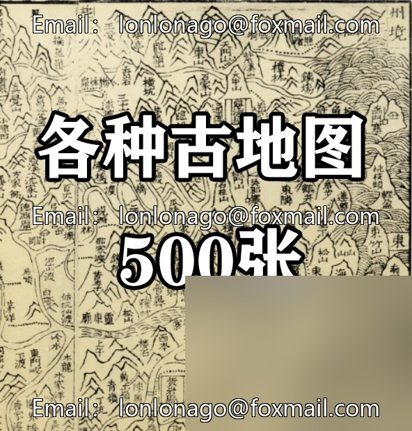
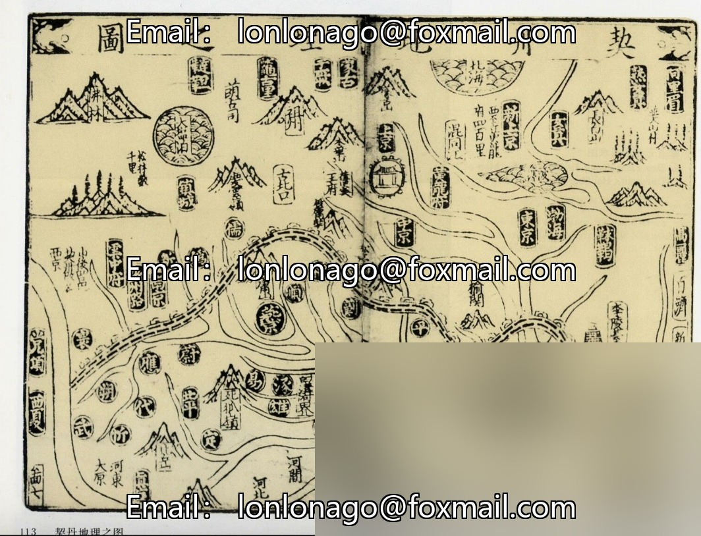
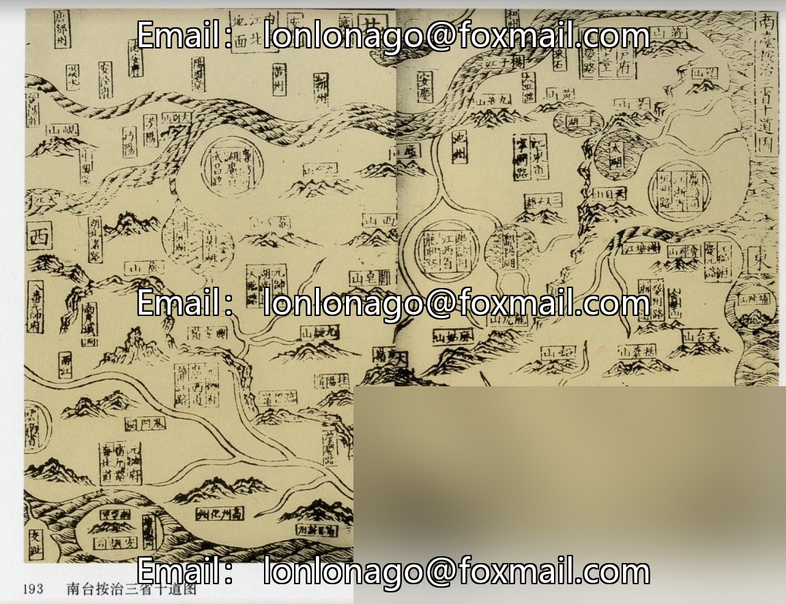
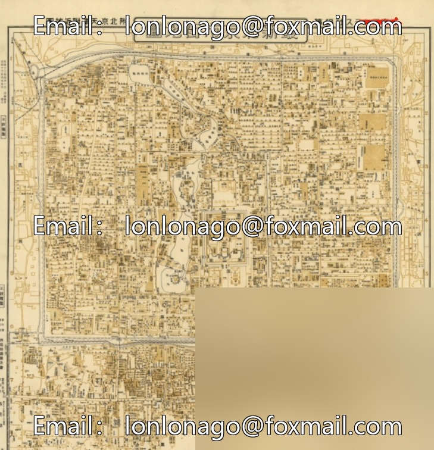
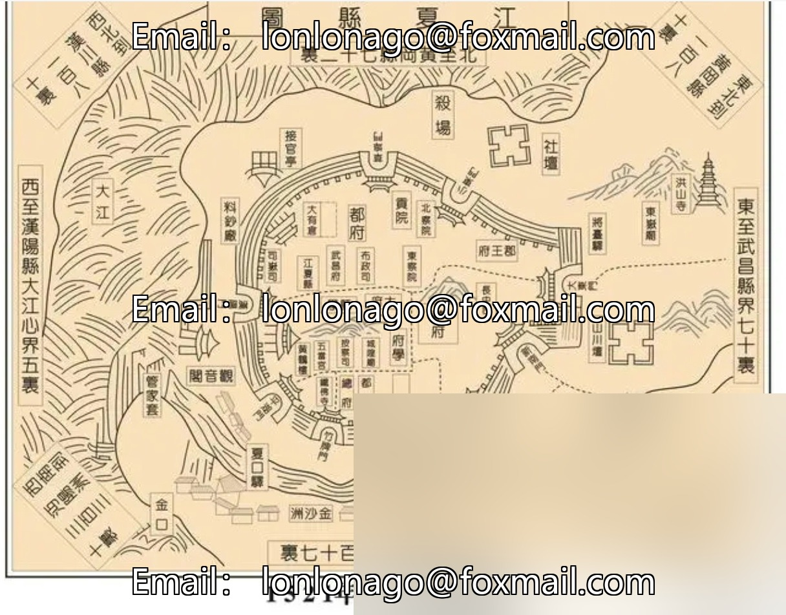
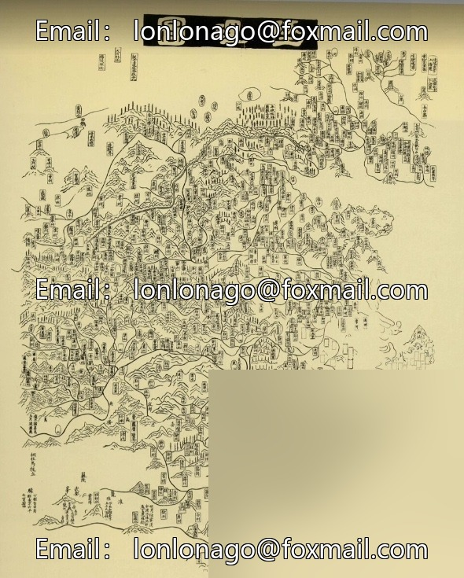
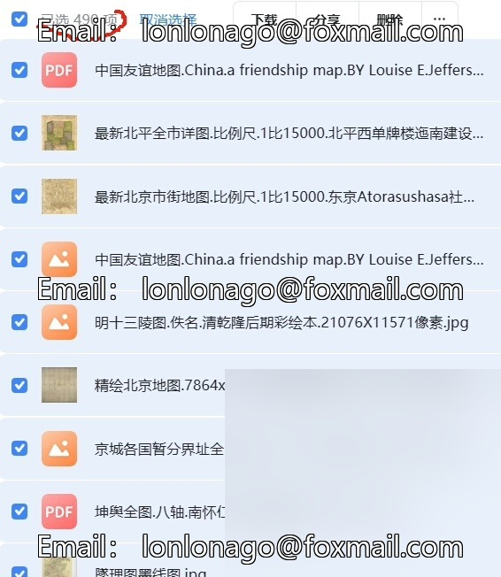

# Ancient Chinese map - image materials - old maps and impressions of ancient historical cities in China, for understanding and learning about them.

## Body

Ancient map - image materials - precious materials for learning ancient history, including old maps of ancient Chinese historical cities and shards, covering a total of 490 images. Some images are of ancient time with generally average clarity; please be aware.

shared via online platform, can be directly purchased.
Available online, shipped immediately.

Ancient Chinese historical city maps, seed maps and other map materials are provided; there are 490 images in total, though some are dated and of mediocre clarity.

<!-- AI_ENRICHED -->

## Images

## Payment

Here is a pay link on Stripe ( https://buy.stripe.com/3cs8yP7sY87d0vu9AB ). Please contact me lonlonago@foxmail.com after funding $89, and I will send you a complete data files , thank you!

